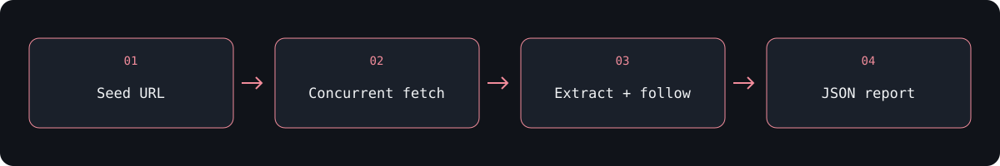
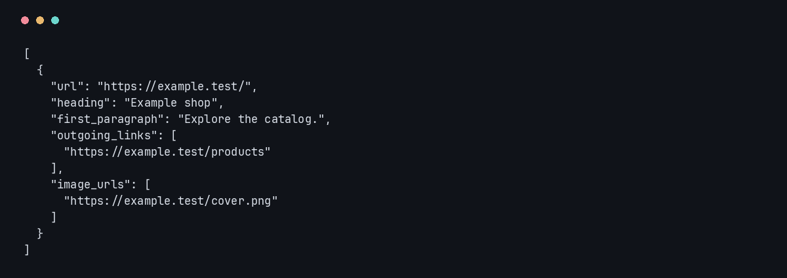

# SiteLens — Web Crawler

**Collect a website’s headings, links, and images into a structured JSON report.**

Start with a URL and follow links on the same network location. A fixed worker pool shares a bounded frontier while visited-page tracking prevents duplicate work. The crawler extracts page data and writes it in URL order to `report.json`.

[Run a crawl](#-quick-start)

##  Features

- Launch a centered keyboard-driven workspace with `./launch`.
- Choose crawl presets, follow live progress, and switch between four themes.
- Extract headings, links, images, and a representative paragraph, preserving word boundaries across inline elements.
- Bound crawl work with page, depth, concurrency, and request limits.
- Respect robots.txt and keep failures in a separate report.
- Write deterministic JSON output with atomic replacement.

##  Installation

Clone with `git clone https://github.com/yaqyn/sitelens-web-crawler.git`, then run the commands below from `sitelens-web-crawler/`.

Requires **[uv](https://docs.astral.sh/uv/getting-started/installation/)** and a terminal. The launcher uses uv to prepare Python 3.13+ and install the locked project dependencies automatically on first run. No manual virtual environment or dependency setup is needed. The first launch needs internet access to download missing components.

##  Quick start

```bash
./launch
```

Enter a website URL, choose a preset or adjust the limits, and select **Start crawl** (Ctrl+R). Follow progress in **Field notes**. Completed crawls write `report.json` in the current directory; request settings let you choose other report paths.

Run `./launch` without arguments to open the interactive terminal workspace. It works from any directory when invoked by absolute path. You can also use `uv run main.py` with the same arguments.

The centered workspace keeps its controls guide in fixed slots below the scrolling content. It provides keyboard selection, crawl presets, editable limits, live field notes, and four themes based on the cover's midnight atlas palette. Open it with a prefilled URL using `./launch --interactive https://example.com`.

| Control | Action |
| --- | --- |
| Tab / Shift+Tab | Move between controls |
| Arrow keys | Up/Down move between text fields; Left/Right edit text; arrows navigate choices and tabs |
| Enter / Space | Open a choice, select an option, or activate a button |
| F2 / F3 / F4 | Jump to Plan crawl / Field notes / Appearance |
| Alt+Down / Alt+Up | Next / previous control |
| Ctrl+R | Start a crawl |
| Ctrl+S | Stop a crawl, including while a choice is open |
| Escape | Stop the active crawl without writing reports; dismiss an open choice first |
| F1 | Open or close help without replacing crawl status |
| Ctrl+Q | Quit and close active requests |

Appearance offers **Midnight atlas**, **Light parchment**, **High contrast**, and **Terminal colors**, plus comfortable or compact spacing. Focus has a visible border or reverse highlight; states also use text, and there is no animation. Font family and text size follow your terminal settings; use terminal zoom for larger text. Layouts scroll on smaller windows.

For linear output with no full-screen cursor control, use `./launch --plain` or pass a URL directly. `NO_COLOR` disables color while keeping the workspace usable. `TERM=dumb` selects the linear prompt when no URL is given. An explicit `--interactive` opens the workspace while still respecting `NO_COLOR`. To preview the cover colors when your environment sets it:

```bash
env -u NO_COLOR ./launch --interactive
```

The linear mode is intended for screen readers and simple terminals; compatibility with individual assistive technologies has not been audited. Plain mode accepts the same limit and report flags as command mode.

A successful command-mode crawl prints a summary and writes `report.json` in the current directory. Stop with **Ctrl+C**; interrupted crawls do not replace the report.

##  Usage

For a crawl without the full-screen workspace:

```bash
./launch https://learnwebscraping.dev/practice/ecommerce/ 3 20 --delay 0.5
```

```text
./launch BASE_URL [MAX_CONCURRENCY] [MAX_PAGES] [OPTIONS]
```

Defaults are **5 workers** and **100 scheduled URLs**. Use positive integers. Failed fetches count toward the scheduled URL limit, so the report may contain fewer pages. The command reports crawl progress and writes `report.json` in the current directory. It fetches the seed only once, without dumping its HTML.

```bash
./launch https://example.com 3 50 --max-depth 2 --delay 0.5 --output reports/pages.json --errors reports/errors.json
```

| Option | Behavior |
| --- | --- |
| `--interactive` | Open the terminal workspace, optionally prefilled with a URL and CLI limits |
| `--plain` | Use a linear URL prompt when no URL is supplied |
| `--theme NAME` | Initial workspace theme: `atlas`, `parchment`, `contrast`, or `textual-ansi` |
| `--output PATH` | Sorted JSON page report; creates parent directories |
| `--errors PATH` | Optional sorted JSON list of failed URLs and errors |
| `--max-depth N` | Limit link hops from the seed; `0` fetches only the seed |
| `--delay SECONDS` | Minimum interval between request starts across all workers |
| `--timeout SECONDS` | Per-request timeout; default 30 seconds |
| `--retries N` | Retry transient connection failures, timeouts, and selected HTTP errors; default 2 |
| `--max-bytes N` | Maximum decoded response-body bytes; default 2,000,000 |
| `--quiet` | Hide per-page progress; retain final summary |
| `--ignore-robots` | Explicitly disable robots.txt checks |

Robots.txt is checked by default, including before following redirects. A missing file (404) allows crawling; other HTTP failures, redirects on robots.txt, or connection errors block the crawl. A declared `Crawl-delay` raises the configured request interval. Parsing uses Python's [RobotFileParser](https://docs.python.org/3/library/urllib.robotparser.html); this is not a complete implementation of every robots directive.

Redirects are followed only within the original network location and relative links use the final page URL. The original report field names are preserved. Report replacement is atomic, so a failed serialization leaves an existing report intact. A run with no successful pages returns exit status 1; partial success returns 0 and failures are available through `--errors`. Ctrl+C returns 130 and closes workers and connections; interrupted crawls do not write a new report.

##  Report workflow

A bounded frontier feeds asynchronous workers; extracted page records become a URL-sorted JSON report.



| Report field | Content |
| --- | --- |
| `url` | Page URL |
| `heading` | First `h1`, falling back to `h2` |
| `first_paragraph` | First paragraph in `main`, or in the page if `main` is absent |
| `outgoing_links` | Links resolved against the page URL |
| `image_urls` | `img` and `picture source` URLs from `src`, responsive `srcset`, and common lazy-loading `data-src`/`data-srcset`, resolved against the page URL |



<sub>Local demonstration fixture; no live website data.</sub>

##  Project structure

| File | Responsibility |
| --- | --- |
| `main.py` | CLI, shared session, workers, request policies, and crawl limits |
| `terminal_ui.py` / `terminal_ui.tcss` | Interactive workspace, themes, keyboard controls, and live crawl notes |
| `crawl.py` | URL normalization and Beautiful Soup extraction |
| `json_report.py` | Sorted, indented, atomic JSON output |
| `test_crawl.py` | Extraction compatibility tests |
| `test_terminal_ui.py` | Keyboard navigation, fixed layout, themes, event bursts, and cancellation checks |
| `test_async_crawler.py` | Local HTTP integration, scheduling, cancellation, CLI, and report tests |

##  Verification

```bash
uv run python -m unittest -v
```

Tests use a local HTTP server and require no external websites. GitHub Actions runs them on every push and pull request.

##  Security and limitations

The crawler processes HTML responses without rendering JavaScript. Visit identity uses the network location and path, ignoring query strings and trailing slashes. Outgoing links can appear in the report even when their destinations are outside the crawl scope. The frontier holds at most the configured number of scheduled URLs, and only the fixed workers fetch pages. HTML extraction parses each page once. Requests use a shared [aiohttp session](https://docs.aiohttp.org/en/stable/client_quickstart.html).

This project explores async workers, queues, shared state, cancellation, request policies, HTML parsing, and structured output.

---

Built by **[Abdulrahman M. Yaqyn](https://yaqyn.github.io/folio-static-site/)**.

> **Learning Journey Project · Boot.dev**
> Developed through the Boot.dev curriculum and extended through independent work.
